# Abordo

Plataforma móvil para la gestión y consulta de información del transporte terrestre en Pasto.

Abordo centraliza la información de los tres puntos de transporte de la ciudad (Terminal de Transportes de Pasto, Terminal Mixto y Terminal Torobajo) para que cualquier persona consulte y compare rutas, destinos, horarios, tarifas y empresas desde el celular, planifique su viaje y, como funcionalidad extra, compre el tiquete.

Proyecto final de Diseño de Software.

| Aplicación | API en la nube | Documentación de la API (Swagger) | Wiki |
|:---:|:---:|:---:|:---:|
| [abordo-pi.vercel.app](https://abordo-pi.vercel.app) | [abordo-backend-myc1.onrender.com](https://abordo-backend-myc1.onrender.com/api/puntos) | [Swagger](https://abordo-backend-myc1.onrender.com/swagger-ui.html) | [Ver wiki](https://github.com/abordo-pasto/abordo/wiki) |

> El backend está en el plan gratuito de Render. El workflow `keep-alive.yml` lo visita cada 10 minutos de 6:00 a. m. a 10:00 p. m. (hora de Colombia); fuera de ese horario la primera petición puede tardar cerca de un minuto.

## Contenido

- [Funcionalidades](#funcionalidades)
- [Tecnologías](#tecnologías)
- [Arquitectura](#arquitectura)
- [Capturas](#capturas)
- [Ejecución local](#ejecución-local)
- [Cuentas de prueba](#cuentas-de-prueba)
- [Pruebas](#pruebas)
- [Despliegue](#despliegue)
- [Probar la API desplegada](#probar-la-api-desplegada-sin-el-frontend)
- [Endpoints REST](#endpoints-rest)
- [Estructura del repositorio](#estructura-del-repositorio)

## Funcionalidades

| Actor | Qué puede hacer | Historias |
|---|---|---|
| Visitante (sin cuenta) | Ver los puntos de transporte y sus destinos, buscar salidas, compararlas y ver asientos. Registrarse. | HU_001, HU_008, HU_009, HU_014, HU_015 |
| Pasajero | Todo lo anterior, más comprar, consultar y cancelar sus tiquetes. | HU_002, HU_010, HU_011, HU_012 |
| Operador de empresa | Gestionar los buses, rutas y salidas **de su empresa** y ver sus ventas. | HU_004, HU_005, HU_006, HU_007 |
| Administrador | Gestionar puntos de transporte, empresas y operadores, y ver las ventas de todas las empresas. | HU_003, HU_007, HU_013, HU_016 |
| Pasarela de pagos (sistema externo) | Aprueba o rechaza el pago de un tiquete (simulada). | HU_010 |

Las historias de usuario, con criterios de aceptación y mockups, están en [docs/historias](docs/historias/00-resumen.md) y en la [wiki](https://github.com/abordo-pasto/abordo/wiki). Los requisitos están en [docs/02-requisitos.md](docs/02-requisitos.md).

**Reglas de negocio principales**

- Precio final = precio base − descuento por tipo de pasajero + tasa de uso de la terminal ($3.000).
- Descuentos: General 0 %, Estudiante 10 %, Adulto mayor 20 %. Están en `model/tarifa/` (una clase por tipo).
- Un asiento solo se vende una vez por salida, y un tiquete se cancela solo con más de 2 horas de anticipación.
- El tiquete solo se emite si la pasarela de pagos aprueba el pago.

## Tecnologías

| Capa | Tecnología |
|---|---|
| Frontend | React 18 + Vite, diseño móvil (mismas pantallas de los mockups) |
| Backend | Java 17, Spring Boot 3 (Web, Data MongoDB, Security, Validation) |
| Base de datos | MongoDB |
| Seguridad | JWT y contraseñas con BCrypt |
| Documentación de la API | Swagger (springdoc-openapi) |
| Pruebas | JUnit 5, Mockito y una colección de Postman (se ejecuta con Newman en GitHub Actions) |
| Contenedores | Docker y Docker Compose |
| Modelado | Visual Paradigm |

## Arquitectura

El backend sigue una arquitectura por capas: **Controlador → Servicio → Repositorio → Modelo**, con DTO para la entrada y la salida.

| Paquete | Responsabilidad | Patrón GRASP |
|---|---|---|
| `controller` | Recibe las peticiones HTTP y delega en el servicio | Controlador |
| `service` | Reglas de negocio de cada historia de usuario | Alta cohesión, Bajo acoplamiento |
| `repository` | Acceso a MongoDB con Spring Data | Fabricación pura |
| `model` | Clases de la vista lógica (`Usuario`, `Salida`, `Tiquete`…) | Experto, Creador |
| `model/tarifa` | `CalculadoraTarifa` y sus tres implementaciones | Polimorfismo |
| `integracion` | `PasarelaPagos` y la pasarela simulada | Indirección, Variaciones protegidas |
| `dto` | Datos de entrada y salida de la API | |
| `security` | JWT y usuario actual | |
| `exception` | Errores con código HTTP y mensaje en español | |
| `config` | Seguridad, Swagger, zona horaria y datos de prueba | |

Ejemplos en el código:

- **Experto:** `Salida.asientosLibres()` y `Ruta.calcularLlegada()` porque cada clase tiene los datos que necesita.
- **Creador:** `Salida.emitirTiquete()` crea el `Tiquete`.
- **Polimorfismo:** `TarifaGeneral`, `TarifaEstudiante` y `TarifaAdultoMayor` implementan `CalculadoraTarifa`.
- **Indirección:** `TiqueteServicio` usa la interfaz `PasarelaPagos`, no la pasarela concreta.

### Diagramas (modelo 4+1)

Los diagramas se hicieron en Visual Paradigm y salen de las historias de usuario. El detalle de cada uno está en [diagramas/README.md](diagramas/README.md).

**Vista de contexto (nivel 0):** Abordo con sus cinco actores externos.

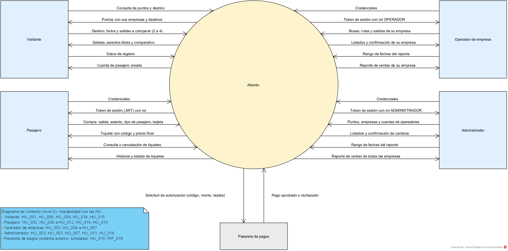

**Vista funcional:** interfaces que ofrece el sistema.

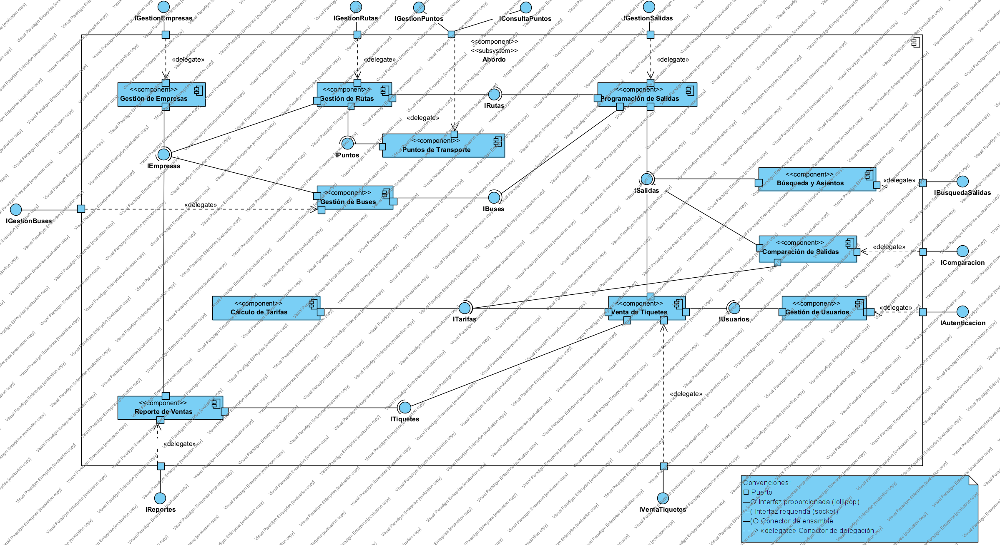

**Vista lógica:** clases del dominio con sus asociaciones, multiplicidades y patrones GRASP.

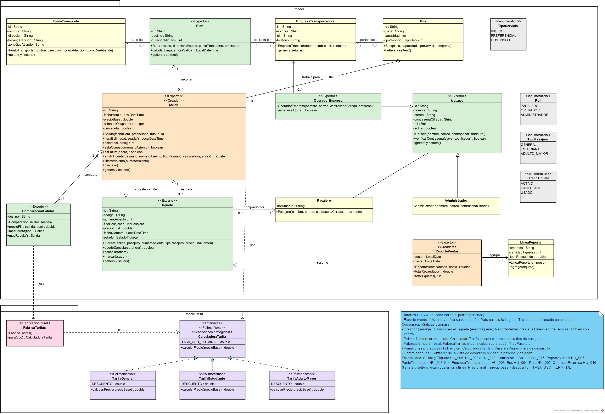

**Vista de desarrollo:** clases por capas (Controller, Service, Repository y modelo de dominio).

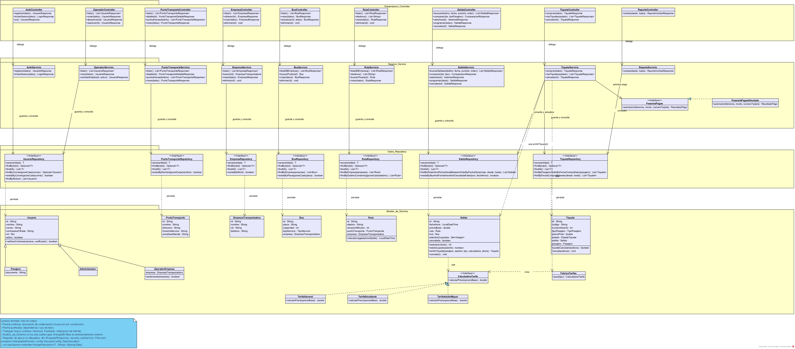

**Vista de despliegue:** Vercel, Render, MongoDB Atlas y GitHub.

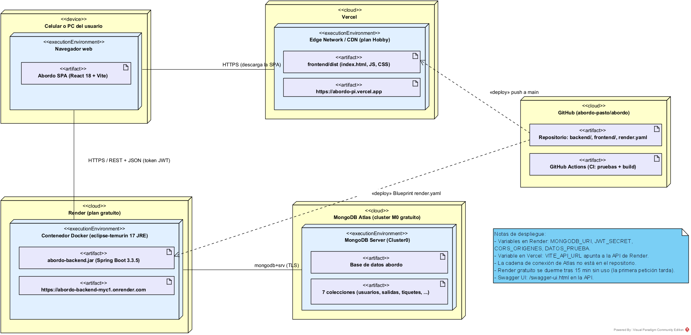

**Escenarios (diagramas de secuencia):** comprar tiquete (HU_010) y buscar salidas (HU_008).

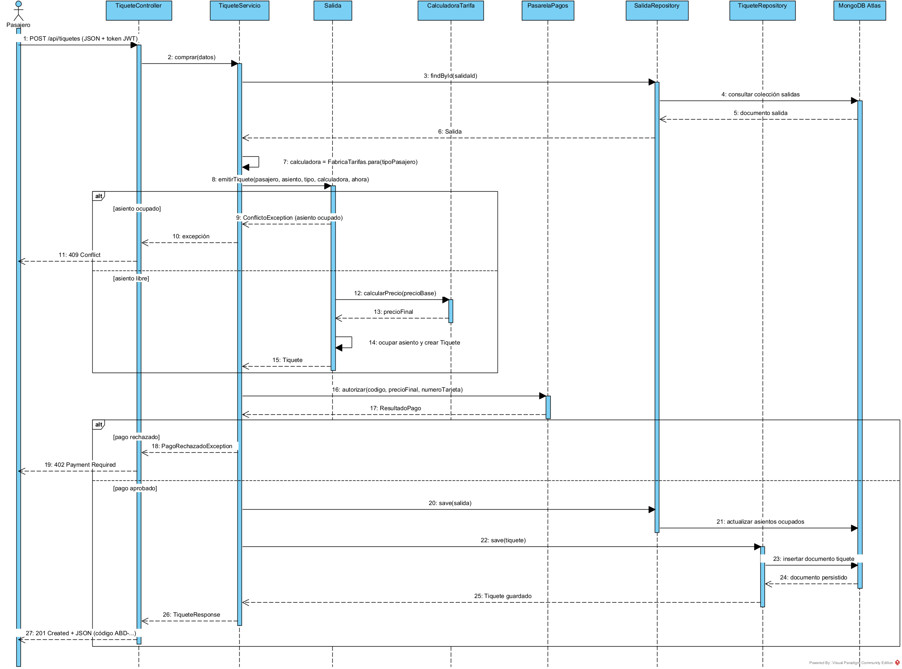

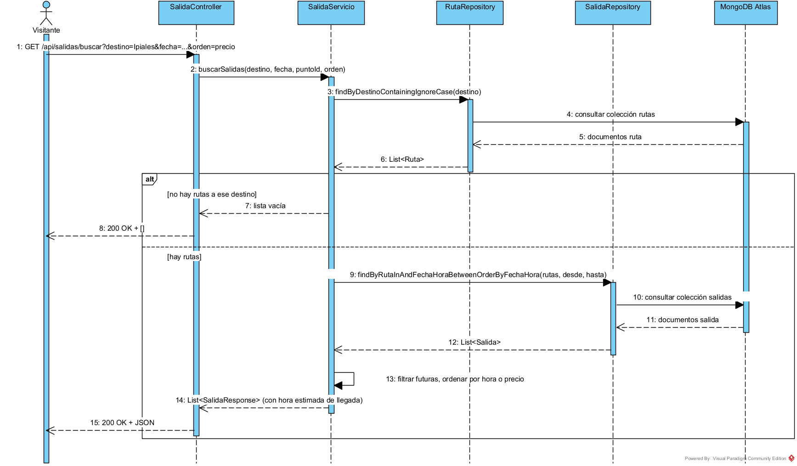

## Capturas

| Inicio | Punto de transporte | Salidas | Comparar |
|:---:|:---:|:---:|:---:|
| 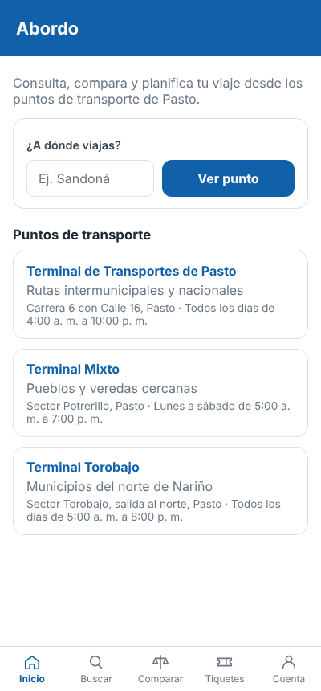 | 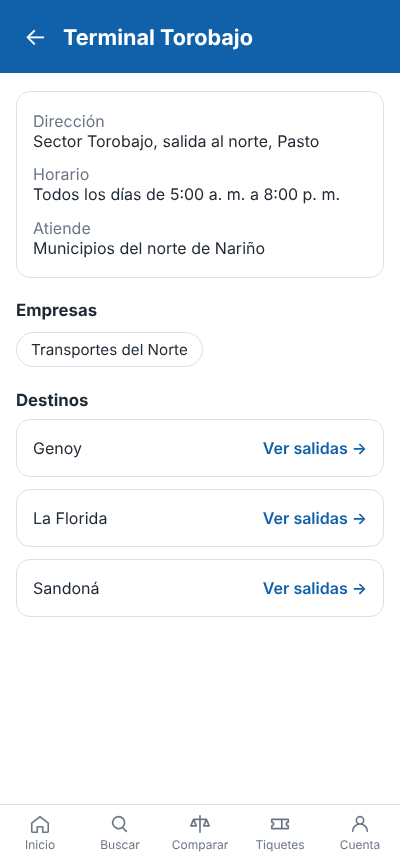 | 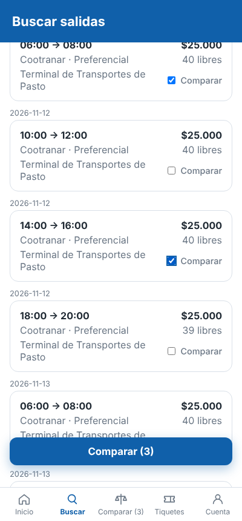 | 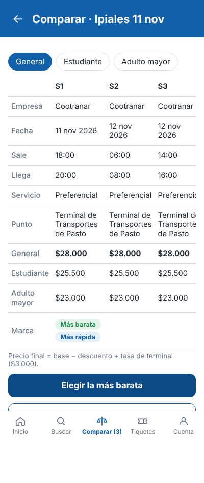 |
| **Asientos y pago** | **Mis tiquetes** | **Panel del operador** | **Panel del administrador** |
| 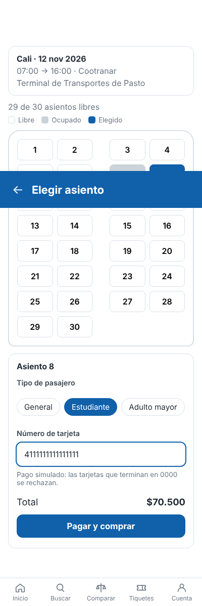 | 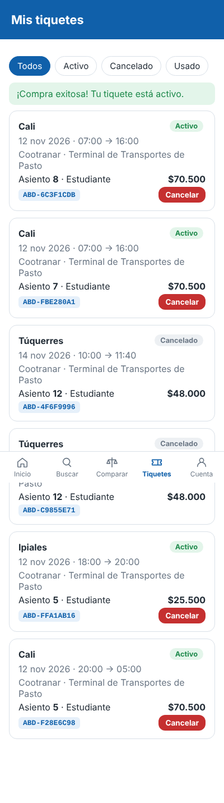 | 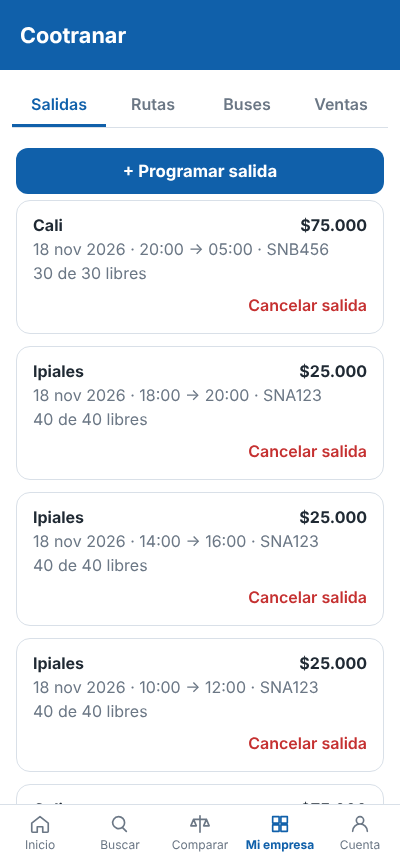 | 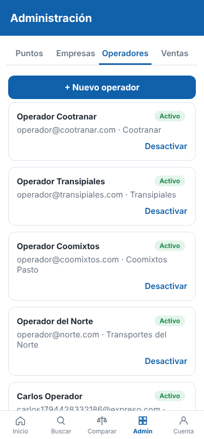 |

Todas las capturas están en [docs/capturas](docs/capturas).

## Ejecución local

**Requisitos:** Java 17 y Maven, MongoDB (o Docker) y Node.js 20 o superior para el frontend.

Con Docker (levanta MongoDB y el backend):

```bash
docker compose up --build
```

Sin Docker, con MongoDB corriendo en `localhost:27017`:

```bash
cd backend
mvn spring-boot:run
```

Frontend (con el backend corriendo):

```bash
cd frontend
cp .env.example .env
npm install
npm run dev
```

La app queda en `http://localhost:5173`. La API queda en `http://localhost:8080` y Swagger en `http://localhost:8080/swagger-ui.html`. La primera vez que arranca carga los tres puntos de transporte, empresas, buses, rutas y las salidas de la próxima semana.

Variables de entorno (ver `backend/.env.example`): `MONGODB_URI`, `JWT_SECRET`, `CORS_ORIGENES` y `DATOS_PRUEBA`.

## Cuentas de prueba

| Rol | Correo | Contraseña |
|---|---|---|
| Administrador | `admin@abordo.com` | `admin123` |
| Pasajero | `pasajero@abordo.com` | `pasajero123` |
| Operador de Cootranar | `operador@cootranar.com` | `operador123` |
| Operador de Transipiales | `operador@transipiales.com` | `operador123` |
| Operador de Coomixtos | `operador@coomixtos.com` | `operador123` |
| Operador de Transportes del Norte | `operador@norte.com` | `operador123` |

Pasarela simulada: cualquier tarjeta de 16 dígitos se aprueba (por ejemplo `4111111111111111`), excepto las que terminan en `0000`, que se rechazan.

## Pruebas

```bash
cd backend
mvn test
```

- Pruebas unitarias del dominio: tarifas, salida, tiquete, comparación y reporte de ventas.
- `TiqueteServicioTest`: compra con pago aprobado y rechazado, simulando la pasarela con Mockito.
- [postman/Abordo.postman_collection.json](postman/Abordo.postman_collection.json): 58 peticiones organizadas por historia de usuario, con sus validaciones. Se importa en Postman y se ejecuta con el Runner, en orden.

GitHub Actions compila el backend y el frontend, corre las pruebas y ejecuta la colección de Postman contra un MongoDB real en cada push.

## Despliegue

| Parte | Plataforma | Configuración |
|---|---|---|
| Backend (Docker) | Render | `render.yaml` y `backend/Dockerfile` |
| Base de datos | MongoDB Atlas (M0 gratuito) | Cadena de conexión en la variable `MONGODB_URI` |
| Frontend | Vercel | Carpeta raíz `frontend` y variable `VITE_API_URL` con la URL del backend |

Cada push a `main` vuelve a desplegar el backend y el frontend.

## Probar la API desplegada (sin el frontend)

El backend desplegado en Render, con la base en MongoDB Atlas, se puede usar directamente, sin pasar por la app. Hay dos formas:

**1. Swagger (desde el navegador)**

1. Abrir [abordo-backend-myc1.onrender.com/swagger-ui.html](https://abordo-backend-myc1.onrender.com/swagger-ui.html). Si el servicio estaba dormido, la primera carga tarda cerca de un minuto.
2. En `POST /api/auth/login` pulsar **Try it out** y enviar, por ejemplo, `{"correo": "admin@abordo.com", "contrasena": "admin123"}`.
3. Copiar el `token` de la respuesta, pulsar **Authorize** (arriba a la derecha) y pegarlo.
4. Desde ahí se puede crear, consultar, editar o eliminar cualquier recurso (puntos, empresas, buses, rutas, salidas, tiquetes, reportes) según el rol de la cuenta.

**2. Postman**

1. Importar `postman/Abordo.postman_collection.json` y el entorno `postman/Abordo-Render.postman_environment.json`.
2. Escoger el entorno **Abordo - Render (nube)** y ejecutar la colección completa (Run collection) o petición por petición. Las peticiones de inicio de sesión guardan solas los tokens de cada rol.

Para trabajar contra el backend local se usa el entorno `Abordo-Local.postman_environment.json`.

**Hacer un cambio en el backend:** se modifica el código en `backend/`, se prueba en local (`mvn spring-boot:run` con MongoDB de `docker-compose`) y al hacer push a `main` el CI corre las pruebas y Render vuelve a desplegar solo; en unos minutos el cambio queda en la API de la nube.

## Endpoints REST

| Método | Ruta | Rol | Historia |
|---|---|---|---|
| POST | `/api/auth/registro` | Público | HU_001 |
| POST | `/api/auth/login` | Público | HU_002 |
| GET | `/api/auth/yo` | Con sesión | HU_002 |
| GET | `/api/puntos` · `/api/puntos/{id}` · `/api/puntos/hacia?destino=` | Público | HU_014 |
| POST · PUT · DELETE | `/api/puntos` | Administrador | HU_013 |
| GET | `/api/empresas` | Público | HU_003 |
| POST · PUT · DELETE | `/api/empresas` | Administrador | HU_003 |
| GET · POST | `/api/operadores` | Administrador | HU_016 |
| PUT | `/api/operadores/{id}/desactivar` · `/reactivar` | Administrador | HU_016 |
| GET · POST · PUT · DELETE | `/api/buses` | Operador | HU_004 |
| GET · POST · PUT · DELETE | `/api/rutas` | Operador | HU_005 |
| GET | `/api/rutas/destinos` | Público | HU_008 |
| GET · POST | `/api/salidas` | Operador | HU_006 |
| PUT | `/api/salidas/{id}/cancelar` | Operador | HU_006 |
| GET | `/api/salidas/buscar?destino=&fecha=&puntoId=&orden=hora\|precio` | Público | HU_008 |
| GET | `/api/salidas/{id}/asientos` | Público | HU_009 |
| GET | `/api/salidas/comparar?ids=a,b&tipoPasajero=` | Público | HU_015 |
| POST | `/api/tiquetes` | Pasajero | HU_010 |
| GET | `/api/tiquetes?estado=` | Pasajero | HU_011 |
| PUT | `/api/tiquetes/{id}/cancelar` | Pasajero | HU_012 |
| GET | `/api/reportes/ventas?desde=&hasta=` | Operador o Administrador | HU_007 |

Los errores responden con el código HTTP correspondiente (400, 401, 402, 403, 404, 409) y un mensaje en español.

## Estructura del repositorio

```
abordo/
├── backend/                     API REST (Java 17 + Spring Boot 3)
│   ├── Dockerfile
│   └── src/main/java/com/abordo/
│       ├── controller/          Endpoints REST
│       ├── service/             Lógica de negocio
│       ├── repository/          Acceso a MongoDB
│       ├── model/               Clases de la vista lógica
│       │   └── tarifa/          CalculadoraTarifa y sus implementaciones
│       ├── integracion/         Pasarela de pagos
│       ├── dto/                 Datos de entrada y salida
│       ├── security/            JWT
│       ├── exception/           Manejo de errores
│       └── config/              Seguridad, Swagger y datos de prueba
├── database/                    Descripción de las colecciones de MongoDB
├── diagramas/                   Diagramas exportados de Visual Paradigm
├── docs/
│   ├── historias/               Historias de usuario (INVEST + Gherkin)
│   ├── mockups/                 Pantallas de la app para cada historia
│   ├── capturas/                Capturas de la app funcionando
│   └── 02-requisitos.md         Requisitos funcionales y no funcionales
├── frontend/                    App móvil (React + Vite)
│   └── src/
│       ├── pages/               Inicio, buscar, comparar, asientos, tiquetes, cuenta y paneles
│       └── components/          Barra inferior, tarjetas y formularios
├── postman/                     Colección de Postman
├── .github/workflows/           CI (compilación, pruebas y Postman) y keep-alive del backend
└── docker-compose.yml           MongoDB + backend en local
```

## Autor

**Felipe Cerón**
Diseño de Software
