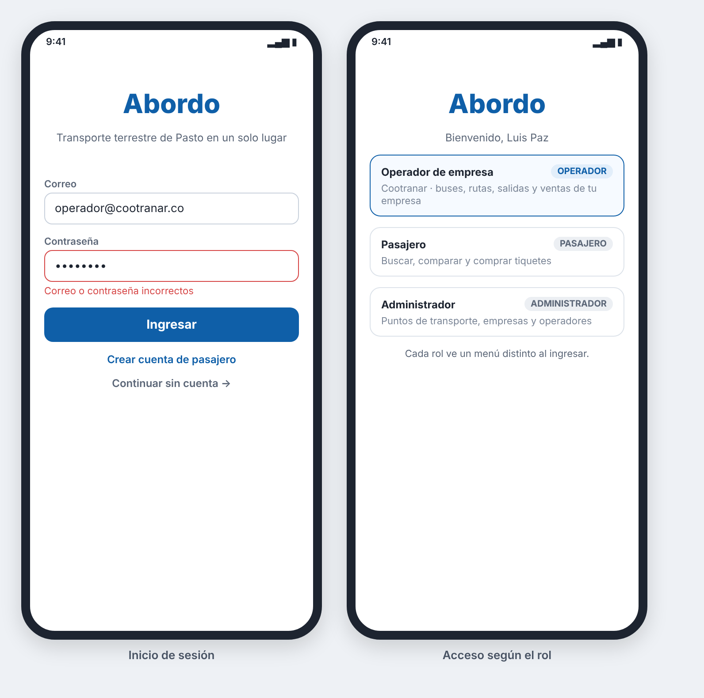

### HU_002: Iniciar sesión

**Como** usuario registrado (pasajero, operador de empresa o administrador)
**Quiero** iniciar sesión con mi correo y contraseña
**Para** acceder a las funciones que corresponden a mi rol

**Prioridad:** Alta · **Estimación:** 3 puntos · **Requisitos:** RF_002

**Mockup**



**Validación INVEST**
- I — Independent: ⚠️ Para probarla con un pasajero se necesita una cuenta (HU_001); se puede probar con las cuentas de los datos iniciales.
- N — Negotiable: ✅ No impone un mecanismo de sesión concreto.
- V — Valuable: ✅ Separa lo que puede hacer cada rol: pasajero, operador de empresa y administrador.
- E — Estimable: ✅ Solo dos resultados posibles: entra o no entra.
- S — Small: ✅ Una sola acción.
- T — Testable: ✅ Resultado y mensaje exactos en cada caso.

**Criterios de aceptación (Gherkin)**
```gherkin
# language: es
Característica: Inicio de sesión

  Esquema del escenario: Inicio de sesión correcto
    Dado que existe la cuenta "<correo>" con contraseña "Clave123" y rol "<rol>"
    Cuando el usuario inicia sesión con "<correo>" y "Clave123"
    Entonces el sistema le da acceso
    Y le muestra su nombre y su rol "<rol>"

    Ejemplos:
      | correo                | rol           |
      | ana@correo.com        | Pasajero      |
      | operador@cootranar.co | Operador      |
      | admin@abordo.co       | Administrador |

  Esquema del escenario: Inicio de sesión con datos incorrectos
    Cuando el usuario inicia sesión con correo "<correo>" y contraseña "<contraseña>"
    Entonces el sistema no le da acceso
    Y muestra el mensaje "Correo o contraseña incorrectos"

    Ejemplos:
      | correo              | contraseña |
      | ana@correo.com      | Otra999    |
      | nadie@correo.com    | Clave123   |
```

**Supuestos / preguntas abiertas**
- El mensaje de error es el mismo si el correo no existe o si la contraseña está mal, para no revelar qué correos están registrados.
- No hay bloqueo por intentos fallidos.
- El operador queda ligado a una sola empresa y solo ve la información de esa empresa.
