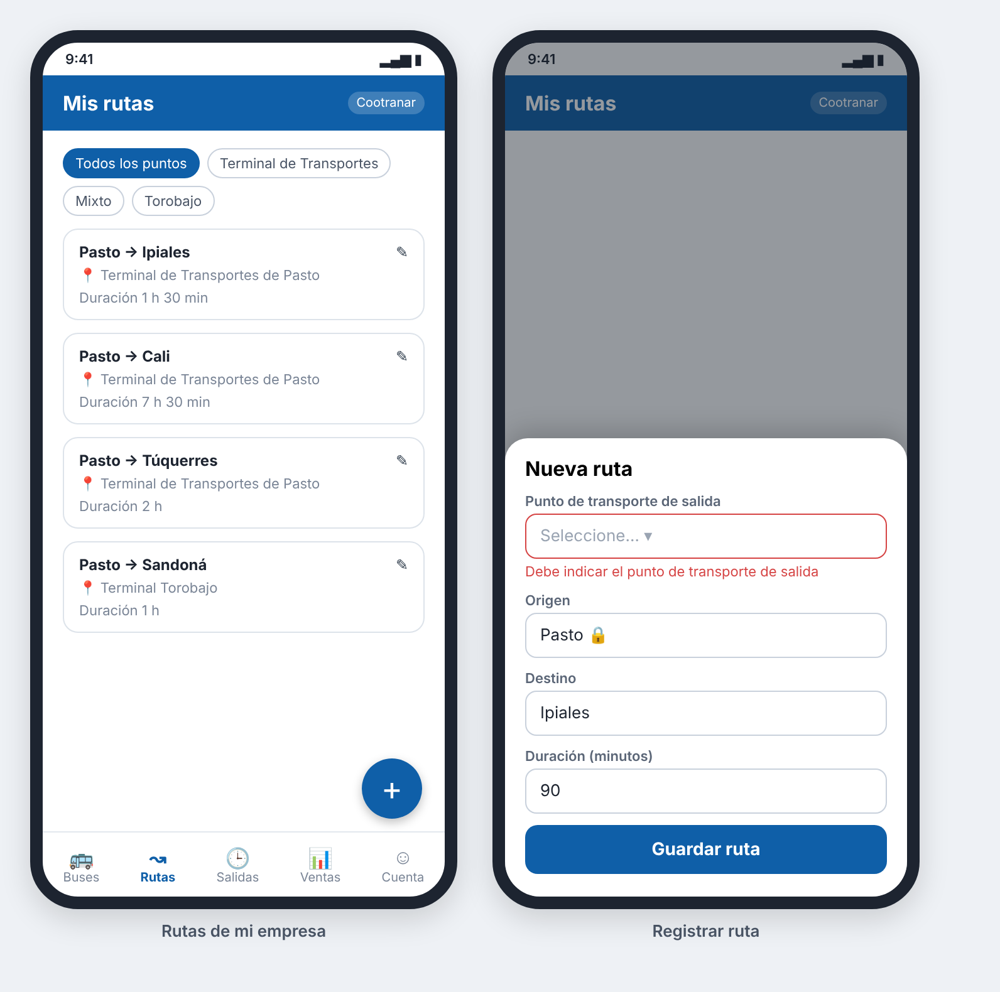

### HU_005: Gestionar rutas

**Como** operador de una empresa transportadora
**Quiero** registrar las rutas de mi empresa indicando el punto de transporte de donde salen, el destino y la duración
**Para** que los pasajeros sepan desde qué punto de Pasto sale cada destino

**Prioridad:** Alta · **Estimación:** 2 puntos · **Requisitos:** RF_005

**Mockup**



**Validación INVEST**
- I — Independent: ⚠️ La ruta pertenece a una empresa (HU_003) y sale de un punto (HU_013); se puede probar con datos iniciales.
- N — Negotiable: ✅ No impone cómo se guardan las rutas.
- V — Valuable: ✅ Sin rutas no hay destinos para consultar ni comparar.
- E — Estimable: ✅ Tres validaciones claras.
- S — Small: ✅ Entidad simple.
- T — Testable: ✅ Cada validación tiene un resultado exacto.

**Criterios de aceptación (Gherkin)**
```gherkin
# language: es
Característica: Gestión de rutas

  Esquema del escenario: Registrar una ruta desde un punto de transporte
    Dado que existen la empresa "<empresa>" y el punto "<punto>"
    Cuando el operador de "<empresa>" registra una ruta desde "<punto>" hacia "<destino>" con duración de <minutos> minutos
    Entonces la ruta aparece en el listado de rutas del punto "<punto>"

    Ejemplos:
      | empresa      | punto                               | destino   | minutos |
      | Cootranar    | Terminal de Transportes de Pasto    | Ipiales   | 90      |
      | Transandoná  | Terminal Torobajo                      | Sandoná   | 60      |
      | Coomixtos    | Terminal Mixto                      | El Encano | 45      |

  Escenario: Ruta sin punto de transporte
    Cuando el operador registra una ruta sin indicar el punto de salida
    Entonces el sistema rechaza el registro
    Y muestra el mensaje "Debe indicar el punto de transporte de salida"

  Escenario: Destino igual a la ciudad de origen
    Cuando el operador registra una ruta con destino "Pasto"
    Entonces el sistema rechaza el registro
    Y muestra el mensaje "El destino debe ser distinto de Pasto"

  Escenario: Duración no válida
    Cuando el operador registra una ruta con duración de 0 minutos
    Entonces el sistema rechaza el registro
    Y muestra el mensaje "La duración debe ser mayor que 0"
```

**Supuestos / preguntas abiertas**
- Todas las rutas salen de Pasto; lo que cambia es el punto de transporte.
- Una empresa puede tener rutas en varios puntos, y dos empresas pueden tener la misma ruta.
- El operador solo registra rutas de su propia empresa; los puntos de transporte los registra el administrador (HU_013).
- Las empresas, destinos y duraciones de los ejemplos son ilustrativos.
