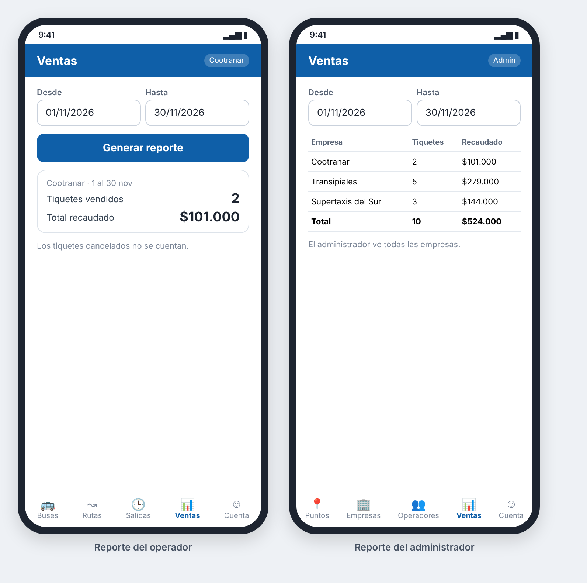

### HU_007: Consultar reporte de ventas

**Como** operador de empresa o administrador
**Quiero** ver cuántos tiquetes se vendieron y cuánto se recaudó por empresa en un rango de fechas
**Para** controlar la operación (el operador, la de su empresa; el administrador, la de todas)

**Prioridad:** Media · **Estimación:** 3 puntos · **Requisitos:** RF_007

**Mockup**



**Validación INVEST**
- I — Independent: ⚠️ Necesita tiquetes vendidos (HU_010); se puede probar con datos iniciales.
- N — Negotiable: ✅ No impone formato de presentación ni de exportación.
- V — Valuable: ✅ Cada empresa conoce sus ventas y el administrador ve el total de la plataforma.
- E — Estimable: ✅ Cálculo definido.
- S — Small: ✅ Una sola consulta con totales.
- T — Testable: ✅ Los totales se pueden comparar con valores exactos.

**Criterios de aceptación (Gherkin)**
```gherkin
# language: es
Característica: Reporte de ventas por empresa

  Antecedentes:
    Dado que entre el "2026-11-01" y el "2026-11-30" la empresa "Cootranar" tiene estos tiquetes:
      | estado    | precio final |
      | Activo    | $53.000      |
      | Usado     | $48.000      |
      | Cancelado | $53.000      |

  Escenario: Reporte con ventas en el rango
    Cuando el administrador pide el reporte del "2026-11-01" al "2026-11-30"
    Entonces ve para "Cootranar" 2 tiquetes vendidos
    Y un total recaudado de $101.000

  Escenario: Los tiquetes cancelados no cuentan
    Cuando el administrador pide el reporte del "2026-11-01" al "2026-11-30"
    Entonces el tiquete cancelado no suma ni a la cantidad ni al total

  Escenario: El operador solo ve su empresa
    Dado que en el mismo rango "Transipiales" también vendió tiquetes
    Cuando el operador de "Cootranar" pide el reporte del "2026-11-01" al "2026-11-30"
    Entonces solo ve la fila de "Cootranar"

  Escenario: El administrador ve todas las empresas
    Cuando el administrador pide el reporte del "2026-11-01" al "2026-11-30"
    Entonces ve una fila por "Cootranar" y otra por "Transipiales"

  Escenario: Rango sin ventas
    Cuando el administrador pide el reporte del "2026-12-01" al "2026-12-31"
    Entonces ve el mensaje "No hay ventas en ese rango"
```

**Supuestos / preguntas abiertas**
- El rango se filtra por la fecha de la salida, no por la fecha de compra.
