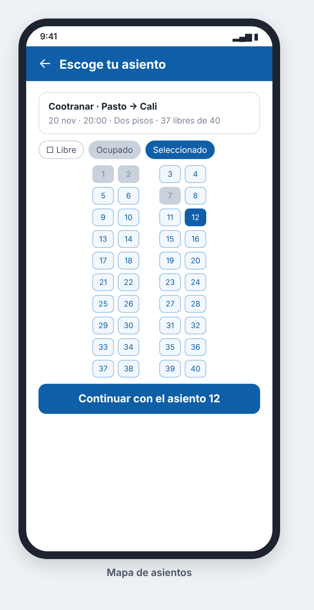

### HU_009: Ver asientos disponibles

**Como** viajero (visitante o pasajero)
**Quiero** ver el mapa de asientos de una salida
**Para** escoger dónde sentarme

**Prioridad:** Media (funcionalidad extra) · **Estimación:** 2 puntos · **Requisitos:** RF_009

**Mockup**



**Validación INVEST**
- I — Independent: ⚠️ Necesita una salida programada (HU_006); se puede probar con datos iniciales.
- N — Negotiable: ✅ No impone cómo se dibuja el mapa.
- V — Valuable: ✅ El pasajero elige su puesto antes de pagar.
- E — Estimable: ✅ Solo dos estados por asiento.
- S — Small: ✅ Una consulta.
- T — Testable: ✅ El estado de cada asiento se puede verificar.

**Criterios de aceptación (Gherkin)**
```gherkin
# language: es
Característica: Mapa de asientos

  Escenario: Ver asientos libres y ocupados
    Dado que la salida a "Cali" del "2026-11-20" a las "20:00" tiene 40 asientos
    Y los asientos 1 y 2 están vendidos
    Cuando el viajero consulta el mapa de asientos de esa salida
    Entonces ve 40 asientos numerados del 1 al 40
    Y los asientos 1 y 2 aparecen ocupados
    Y los demás aparecen libres

  Escenario: Un asiento de un tiquete cancelado vuelve a estar libre
    Dado que el tiquete del asiento 2 fue cancelado
    Cuando el viajero consulta el mapa de asientos de esa salida
    Entonces el asiento 2 aparece libre
```

**Supuestos / preguntas abiertas**
- Ver el mapa de asientos no requiere iniciar sesión; comprar sí (HU_010).
