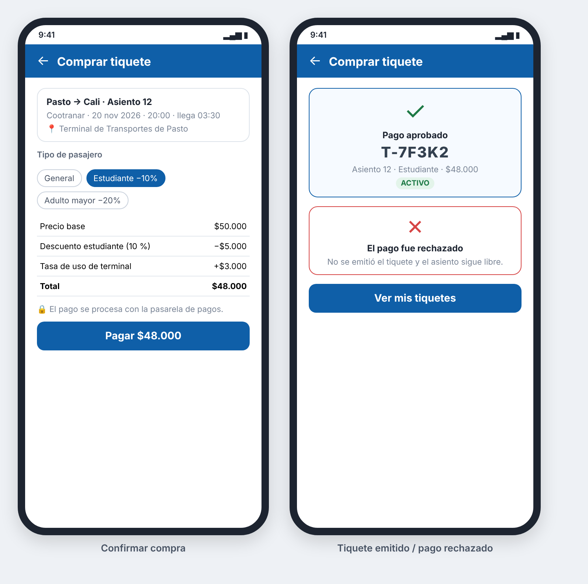

### HU_010: Comprar tiquete

**Como** pasajero
**Quiero** comprar un tiquete eligiendo la salida, el asiento y mi tipo de pasajero
**Para** asegurar mi puesto en el viaje que planifiqué sin hacer fila en el punto de transporte

**Prioridad:** Media (funcionalidad extra) · **Estimación:** 5 puntos · **Requisitos:** RF_010, RF_011, RF_018

**Mockup**



**Validación INVEST**
- I — Independent: ⚠️ Necesita que existan salidas programadas (HU_006); se puede probar con datos de prueba cargados en la base.
- N — Negotiable: ✅ No dice cómo se guarda ni cómo se calcula por dentro, solo el resultado.
- V — Valuable: ✅ Completa la planificación: después de comparar, el pasajero asegura su puesto.
- E — Estimable: ✅ Las reglas de precio y de asiento están definidas (RN1, RN2, RN3, RN4).
- S — Small: ✅ Un solo flujo: elegir asiento, pagar el valor calculado y recibir el tiquete.
- T — Testable: ✅ El precio final y el estado del asiento se pueden verificar con valores exactos.

**Criterios de aceptación (Gherkin)**
```gherkin
# language: es
Característica: Compra de tiquete

  Antecedentes:
    Dado que existe una salida a Cali el "2026-11-20" a las "20:00" con precio base de $50.000
    Y la tasa de uso de la terminal es $3.000

  Esquema del escenario: Precio final según el tipo de pasajero
    Dado que el asiento 12 de esa salida está libre
    Cuando el pasajero compra el asiento 12 como "<tipo>"
    Y la pasarela de pagos aprueba el pago
    Entonces el tiquete queda en estado "Activo"
    Y el precio final es "<precio final>"
    Y el asiento 12 aparece ocupado

    Ejemplos:
      | tipo         | precio final |
      | General      | $53.000      |
      | Estudiante   | $48.000      |
      | Adulto mayor | $43.000      |

  Escenario: Pago rechazado por la pasarela de pagos
    Dado que el asiento 12 de esa salida está libre
    Y la pasarela de pagos rechaza el pago
    Cuando el pasajero intenta comprar el asiento 12
    Entonces no se crea ningún tiquete
    Y el asiento 12 sigue libre
    Y muestra el mensaje "El pago fue rechazado"

  Escenario: Intento de comprar un asiento ocupado
    Dado que el asiento 12 de esa salida ya fue vendido
    Cuando el pasajero intenta comprar el asiento 12
    Entonces el sistema rechaza la compra
    Y muestra el mensaje "El asiento ya está ocupado"

  Escenario: Cada tiquete tiene un código único
    Cuando el pasajero compra dos asientos distintos de la misma salida
    Entonces cada tiquete tiene un código diferente
```

**Supuestos / preguntas abiertas**
- Se compra un asiento por tiquete; para varios asientos se hacen varias compras.
- El pago lo autoriza una pasarela de pagos externa. En el proyecto se usa una pasarela simulada que aprueba o rechaza, detrás de una interfaz para poder cambiar de proveedor sin tocar la venta.
- Para comprar hay que iniciar sesión como pasajero.
