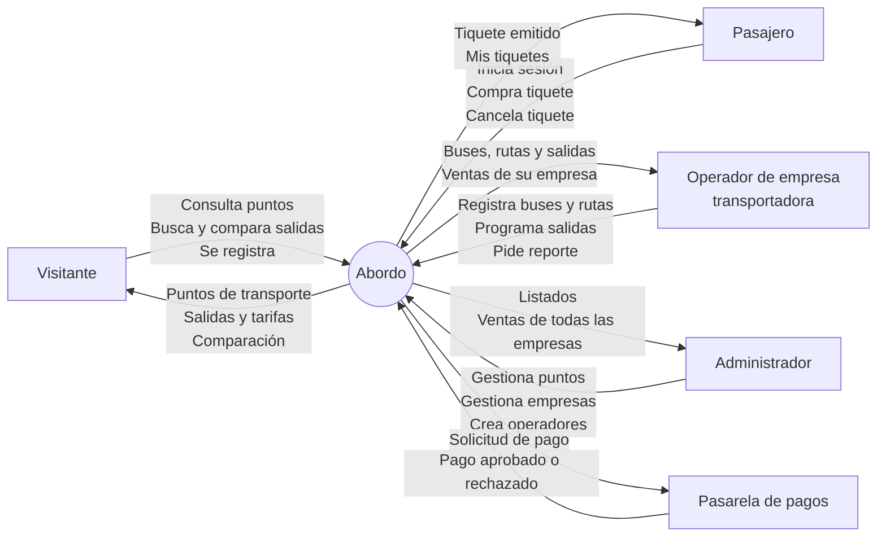
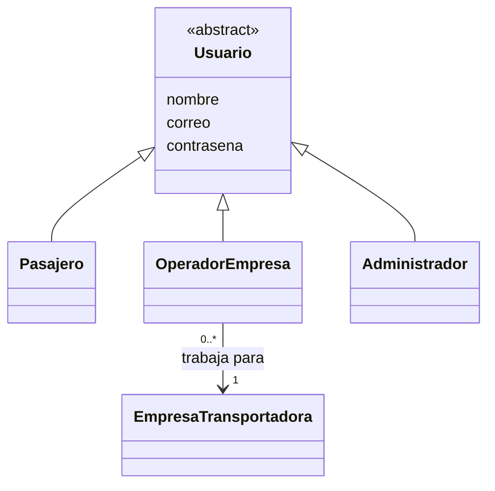

# 02 - Descripción General

## 2.1 Perspectiva del Producto
**Abordo** es un sistema nuevo e independiente. Se compone de un **backend** (API REST en Java + Spring Boot con base de datos MongoDB) y de una **app móvil** que lo consume. Reemplaza la consulta presencial o telefónica en cada punto de transporte por una sola fuente de información con los datos de los tres puntos de Pasto y de las empresas que operan en ellos.

### Diagrama 2.1 – Diagrama de contexto (nivel 0)
El sistema se representa con un círculo y los actores externos con rectángulos. Las flechas que **entran** al sistema son **acciones** y las que **salen** son **datos** que el sistema devuelve.

La base de datos MongoDB es parte del sistema, por eso no aparece como actor externo.

## 2.2 Funciones del Producto

### **Consulta de puntos de transporte**
Muestra los tres puntos de transporte de Pasto con dirección, horario de atención, zona que atienden, empresas y destinos, y responde "¿desde qué punto sale este destino?".

### **Búsqueda y comparación de salidas** (función principal)
Busca salidas futuras por destino y fecha, filtra por punto de transporte, ordena por hora o precio y compara de 2 a 4 salidas mostrando el precio final por tipo de pasajero, la hora estimada de llegada y las marcas "Más barata" y "Más rápida".

### **Gestión de la empresa transportadora**
El operador de cada empresa registra sus buses, rutas y salidas, y consulta las ventas de su empresa.

### **Administración de la plataforma**
El administrador gestiona los puntos de transporte, las empresas transportadoras y las cuentas de los operadores, y consulta las ventas de todas las empresas.

### **Cuentas y roles**
Registro de pasajeros e inicio de sesión con tres roles: pasajero, operador y administrador.

### **Compra de tiquete** (extra)
Mapa de asientos, compra con precio final calculado y pago por pasarela, consulta y cancelación de tiquetes.

```mermaid
flowchart TB
    S[Abordo]
    S --> C[Consulta y planificación]
    S --> E[Gestión de la empresa]
    S --> AD[Administración]
    S --> U[Cuentas y roles]
    S --> T[Compra de tiquete - extra]

    C --> C1[Consultar puntos de transporte]
    C --> C2[Buscar salidas]
    C --> C3[Comparar salidas]

    E --> E1[Gestionar buses]
    E --> E2[Gestionar rutas]
    E --> E3[Programar salidas]
    E --> E4[Reporte de ventas de la empresa]

    AD --> A1[Gestionar puntos de transporte]
    AD --> A2[Gestionar empresas]
    AD --> A3[Gestionar operadores]
    AD --> A4[Reporte de ventas general]

    U --> U1[Registrarse como pasajero]
    U --> U2[Iniciar sesión]

    T --> T1[Ver asientos]
    T --> T2[Comprar tiquete]
    T --> T3[Mis tiquetes]
    T --> T4[Cancelar tiquete]
```

## 2.3 Clases y Características de Usuarios

| Tipo de Usuario | Tipo | Descripción |
|---|---|---|
| Visitante | Persona sin cuenta | Cualquier persona que abre la app sin iniciar sesión. Consulta los puntos de transporte, busca y compara salidas, ve los asientos y puede registrarse. |
| Pasajero | Usuario registrado | Visitante que creó su cuenta. Además de consultar, compra, consulta y cancela sus tiquetes. Puede ser general, estudiante o adulto mayor (tipo de pasajero del tiquete). |
| Operador de empresa | Usuario registrado | Empleado de una empresa transportadora (por ejemplo Cootranar, Transipiales o Coomixtos). Mantiene al día los buses, rutas y salidas **de su empresa** y consulta sus ventas. Su cuenta la crea el administrador. |
| Administrador | Usuario registrado | Encargado de la plataforma. Gestiona los puntos de transporte, las empresas y los operadores, y consulta las ventas de todas las empresas. |
| Pasarela de pagos | Sistema externo | Servicio que autoriza o rechaza el pago de un tiquete. En el proyecto se usa una pasarela simulada. |

Pasajero, Operador de empresa y Administrador son especializaciones de **Usuario**. El Visitante no tiene cuenta, por eso no es una clase del sistema.

## 2.4 Entorno Operativo

- **App móvil:** teléfonos Android e iOS con conexión a internet (la app móvil es el frontend opcional; sin ella, la API se prueba con Postman).
- **Backend:** Java 17 con Spring Boot 3, ejecutable en local (`mvn spring-boot:run`) o desplegado en la nube (AWS).
- **Base de datos:** MongoDB (local o MongoDB Atlas).
- **Pasarela de pagos:** servicio externo, simulado durante el proyecto.
- **Conexión a internet estable:** necesaria para consultar información actualizada.

## 2.5 Restricciones de Diseño
- El backend debe construirse en **Java con Spring Boot** y la base de datos debe ser **MongoDB** (no relacional).
- El backend sigue una **arquitectura por capas**: Controlador → Servicio → Repositorio → Modelo.
- Los diagramas UML se dibujan en **Visual Paradigm**.
- Consultar puntos, buscar y comparar salidas no requiere cuenta; gestionar información y comprar sí.
- Un operador solo puede gestionar la información de su propia empresa.

## 2.6 Documentación para el Usuario
- Esta wiki con las historias de usuario y sus mockups.
- Colección de Postman con ejemplos de cada endpoint.
- README del repositorio con instrucciones de instalación y ejecución.

## 2.7 Supuestos y Dependencias
- El usuario cuenta con un celular con conexión a internet.
- Los datos iniciales traen los tres puntos de transporte de Pasto y una cuenta de administrador.
- Las empresas transportadoras mantienen al día sus salidas por medio de sus operadores.
- La compra depende de la disponibilidad de la pasarela de pagos; la consulta y la comparación no dependen de ella.
