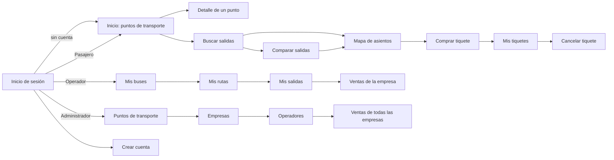

# 03 - Requisitos de Interfaz Externa

---

## 3.1 Interfaces de Usuario

Abordo es una **app móvil** sencilla, pensada para usarse con una mano y sin entrenamiento. Usa un color principal azul, tarjetas para cada resultado, chips para los filtros y mensajes de error en español debajo del campo que falla. El menú inferior cambia según el rol del usuario.

| Rol | Menú inferior |
|---|---|
| Visitante y Pasajero | Inicio · Buscar · Comparar · Tiquetes · Cuenta |
| Operador de empresa | Buses · Rutas · Salidas · Ventas · Cuenta |
| Administrador | Puntos · Empresas · Operadores · Ventas · Cuenta |

### *Mapa de navegación*

### *Pantallas principales (mockups)*

Cada historia de usuario tiene su mockup en su propia página. Estas son las pantallas centrales del flujo principal (consultar → buscar → comparar):

| Consultar puntos (HU_014) | Buscar salidas (HU_008) |
|---|---|
|  |  |

| Comparar salidas (HU_015) | Comprar tiquete (HU_010) |
|---|---|
|  |  |

---

## 3.2 Interfaz de Hardware

- **Teléfonos inteligentes** Android o iOS con pantalla táctil y conexión a internet (datos móviles o wifi).
- **Servidor** para el backend: un equipo local o una instancia en la nube (AWS) con Java 17.
- **Servidor de base de datos** MongoDB (local o MongoDB Atlas).
- No se requiere hardware especial (lector de códigos, impresora, etc.).

---

## 3.3 Interfaz de Software

- **Backend:** Java 17 + Spring Boot 3, organizado por capas (Controlador → Servicio → Repositorio → Modelo) con DTO de entrada y salida.
- **Base de datos:** MongoDB con las colecciones `usuarios`, `puntosTransporte`, `empresas`, `buses`, `rutas`, `salidas` y `tiquetes`.
- **Pasarela de pagos:** servicio externo usado a través de una interfaz propia del sistema; en el proyecto es una implementación simulada.
- **API REST** (formato **JSON**):

| Recurso | Métodos | Quién lo usa | HU |
|---|---|---|---|
| `/api/auth/registro` | POST | Visitante | HU_001 |
| `/api/auth/login` | POST | Todos los usuarios | HU_002 |
| `/api/puntos` | GET, POST, PUT, DELETE | GET: todos · resto: Administrador | HU_013, HU_014 |
| `/api/empresas` | GET, POST, PUT, DELETE | Administrador | HU_003 |
| `/api/operadores` | GET, POST, PATCH | Administrador | HU_016 |
| `/api/buses` | GET, POST, PUT | Operador | HU_004 |
| `/api/rutas` | GET, POST, PUT | Operador | HU_005 |
| `/api/salidas` | GET, POST, PUT | Operador | HU_006 |
| `/api/salidas/buscar` | GET | Visitante, Pasajero | HU_008 |
| `/api/salidas/comparar` | GET | Visitante, Pasajero | HU_015 |
| `/api/salidas/{id}/asientos` | GET | Visitante, Pasajero | HU_009 |
| `/api/tiquetes` | POST | Pasajero | HU_010 |
| `/api/tiquetes/mios` | GET | Pasajero | HU_011 |
| `/api/tiquetes/{id}/cancelar` | PATCH | Pasajero | HU_012 |
| `/api/reportes/ventas` | GET | Operador, Administrador | HU_007 |

- **Postman:** colección para probar todos los endpoints.

---

## 3.4 Interfaz de Comunicación

- **HTTPS** entre la app móvil y el backend.
- **HTTP/REST con JSON** para todas las operaciones.
- **Token de sesión** enviado en cada petición para identificar al usuario y su rol (sin sesiones de navegador).
- **HTTPS** entre el backend y la pasarela de pagos.
