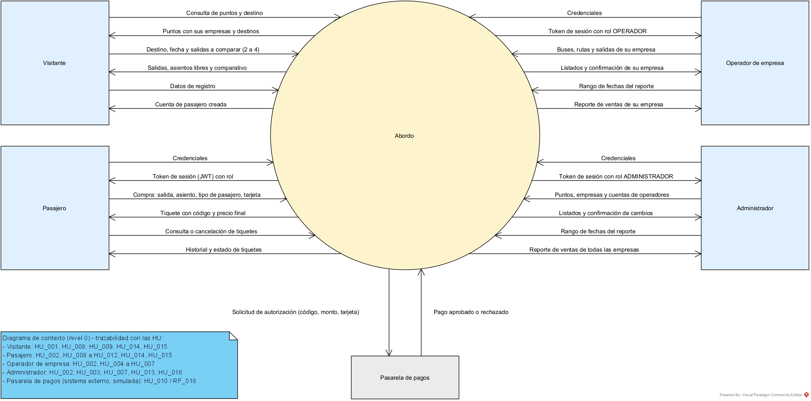
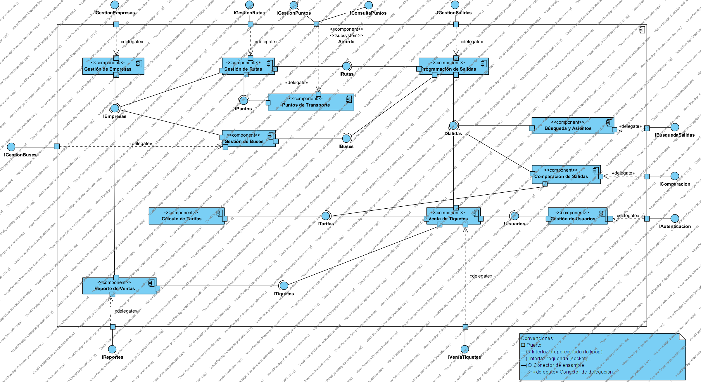
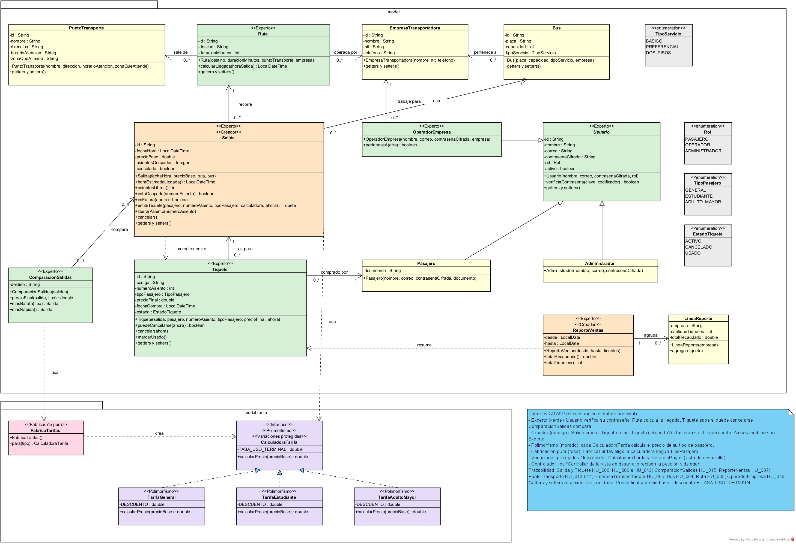
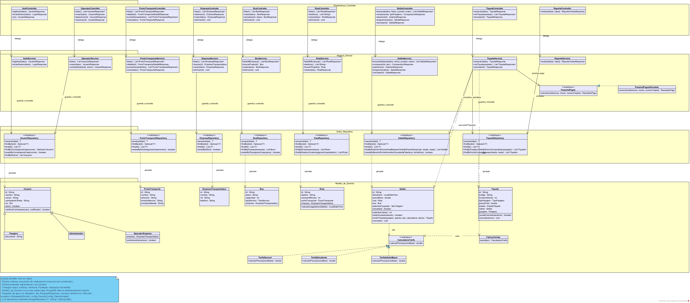
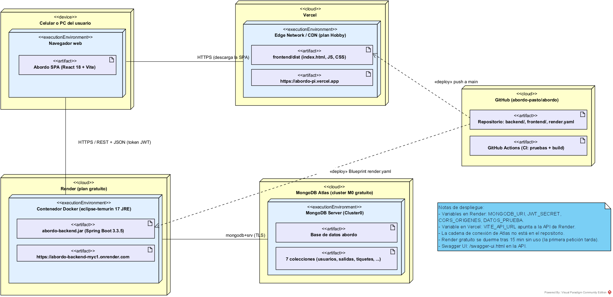
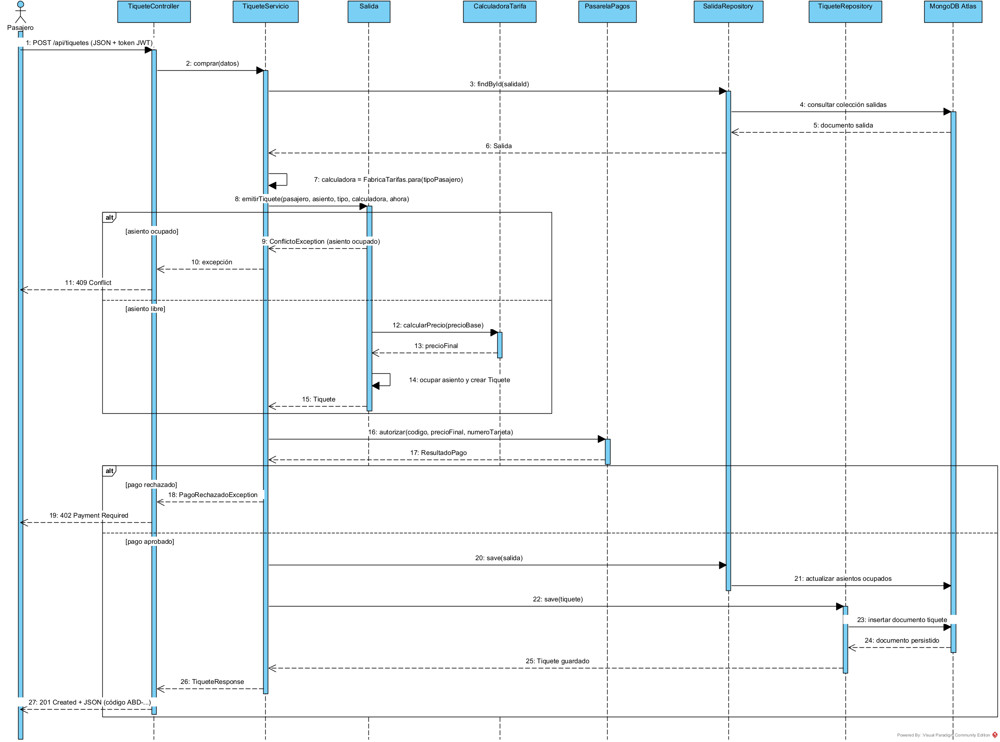
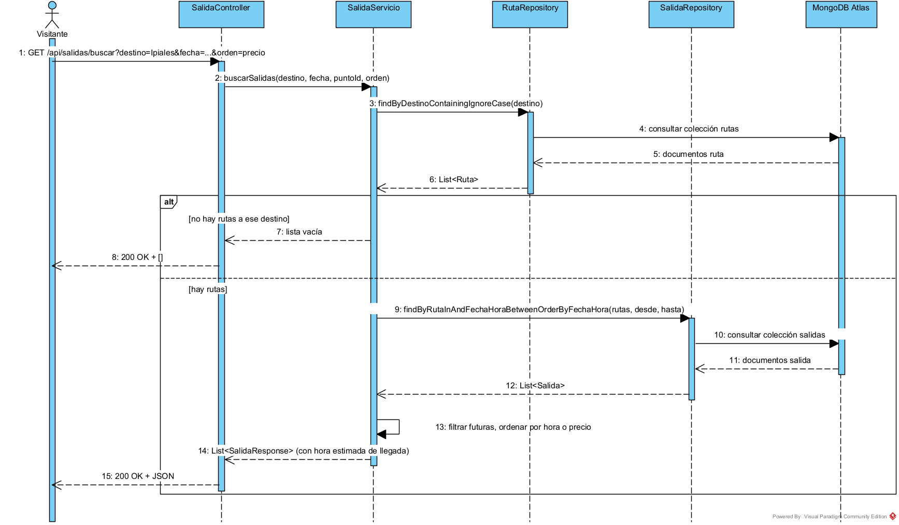

# 06 - Diagramas de Arquitectura

Los diagramas siguen el modelo 4+1 y se hicieron en Visual Paradigm Community Edition. Todos salen de las historias de usuario y de los requisitos (ver [04 - Características del Sistema](04---Características-del-Sistema)).

## Vista 1 — Contexto (nivel 0)

Abordo es un solo proceso. A su alrededor están los cinco actores externos con los datos que envían y reciben: **Visitante**, **Pasajero**, **Operador de empresa**, **Administrador** y la **Pasarela de pagos** (sistema externo, simulada).

## Vista 2 — Funcional (Componentes)

Interfaces que ofrece el sistema por cada grupo de funcionalidades.

## Vista 3 — Lógica (Clases del dominio)

Clases de `com.abordo.model` y `com.abordo.model.tarifa`, con asociaciones nombradas y multiplicidades, la herencia de `Usuario` (Pasajero, Administrador, OperadorEmpresa) y los patrones GRASP marcados con estereotipo y color.

## Vista 4 — Desarrollo (Clases por capas)

Tres capas con el formato visto en clase: **Presentacion_Controller** delega en **Negocio_Service**, que consulta y guarda con **Datos_Repository**. El **Modelo_de_Dominio** es un paquete aparte (no es una cuarta capa). Los repositorios son interfaces de Spring Data y MongoDB no se dibuja como clase.

## Vista 5 — Despliegue

El navegador descarga la SPA desde **Vercel** y consume la API REST en **Render** (contenedor Docker con Java 17), que guarda los datos en **MongoDB Atlas**. **GitHub** despliega ambos con cada push a `main`.

## Escenarios (+1) — Diagramas de secuencia

**Comprar tiquete (HU_010):** asiento ocupado (409), pago rechazado (402) y compra exitosa (201).

**Buscar salidas (HU_008):** sin rutas al destino (200 con lista vacía) y con resultados (200).

## Resumen de patrones GRASP aplicados

| Patrón | Dónde | Por qué |
|---|---|---|
| Controlador | `*Controller` | Reciben la petición HTTP y delegan en el servicio, sin lógica de negocio |
| Experto | `Usuario.verificarContrasena()`, `Ruta.calcularLlegada()`, `Salida.asientosLibres()`, `Tiquete.puedeCancelarse()` | Cada clase tiene los datos para hacerlo |
| Creador | `Salida.emitirTiquete()`, `ReporteVentas` crea sus `LineaReporte` | La salida conoce el asiento y el precio base; el reporte agrupa sus líneas |
| Polimorfismo | `CalculadoraTarifa` → `TarifaGeneral`, `TarifaEstudiante`, `TarifaAdultoMayor` | Cada tipo de pasajero calcula su precio sin `if` por tipo |
| Fabricación pura | `FabricaTarifas` | Elige la calculadora; no es un concepto del dominio |
| Indirección / Variaciones protegidas | `PasarelaPagos` (interfaz) y `PasarelaPagosSimulada` | La venta no depende del proveedor de pagos |
| Bajo acoplamiento / Alta cohesión | Capas controller, service, repository | Cada capa tiene una sola responsabilidad |

## Patrones de diseño (GoF y de arquitectura)

| Patrón | Dónde | Para qué |
|---|---|---|
| Strategy | `CalculadoraTarifa` con `TarifaGeneral`, `TarifaEstudiante`, `TarifaAdultoMayor` | Cambiar la regla de precio según el tipo de pasajero sin `if` en la venta |
| Simple Factory | `FabricaTarifas.para(tipo)` | Un solo lugar decide qué estrategia de tarifa se usa |
| Repository | `*Repository` (Spring Data `MongoRepository`) | El servicio guarda y consulta sin conocer MongoDB |
| DTO | paquete `dto` (`*Request` / `*Response`) | La API no expone las entidades del dominio |
| Inyección de dependencias | constructores de servicios y controladores; `Clock` en `RelojConfig` | Bajo acoplamiento y pruebas con Mockito y hora fija |
| Chain of Responsibility | `FiltroJwt` dentro de la cadena de filtros de Spring Security | Validar el token antes de llegar al controlador |
| Manejador global de errores | `ManejadorErrores` (`@RestControllerAdvice`) | Respuestas de error iguales en toda la API |
| Arquitectura en capas | controller → service → repository + modelo | Cada capa con una sola responsabilidad |
